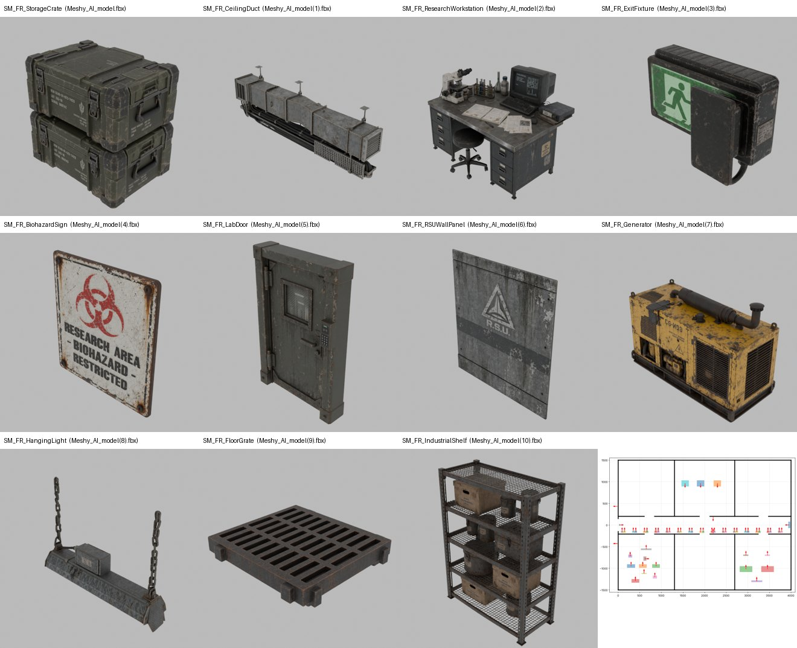

# Meshy Forest Facility: Placement Pass 01 (UE 5.8)

`Tools/place_meshy_forest_props_ue58.py` dresses a **duplicate** of the forest facility map with
the 11 Meshy props: **53 instances**.



## What goes where

| Prop | Model | Placed |
|---|---|---|
| `SM_FR_IndustrialShelf` | steel shelving with boxes | the 4 storage shelves (180 x 80 x 235 cm) |
| `SM_FR_StorageCrate` | two stacked ammo cases | the 3 storage crates (95 x 67 x 89 cm) |
| `SM_FR_ResearchWorkstation` | lab desk, microscope, CRT, stool | the 3 lab benches, stool towards the corridor (170 x 142 x 126 cm) |
| `SM_FR_Generator` | yellow GEN-03 generator | both generators (287 x 135 x 200 cm) |
| `SM_FR_CeilingDuct` | vent duct + cable tray on hangers | hung from the ceiling in storage and the generator room (250 cm long) |
| `SM_FR_HangingLight` | light fitting on chains | ceiling of storage (1) and the generator room (2); it's only a mesh, the room lights stay as they are |
| `SM_FR_FloorGrate` | square drain grate | every corridor grate, two Meshy grates per blockout grate (30), sitting 3 cm proud of the floor |
| `SM_FR_BiohazardSign` | "Research area, biohazard, restricted" | on the corridor walls beside the lab and medical doors |
| `SM_FR_ExitFixture` | green exit sign box | inside, on the entrance header above the way out |
| `SM_FR_LabDoor` | steel door with window + keypad | a locked door at the dead end of the corridor (not in a doorway) |
| `SM_FR_RSUWallPanel` | concrete panel with the RSU logo | outside on the front wall, either side of the entrance |

Every position comes from the layout in `Tools/build_forest_research_ue58.py`. I checked them all
against its walls, doorways and existing props before committing: nothing's in a doorway or
on the walkable route, wall signs sit flush on the wall faces, and ceiling props hang from z 320.

## Read before running
- Import the meshes first with `Tools/import_meshy_forest_ue58.py`. **If you ran an earlier version
  of the importer, delete `/Game/ForestResearch/MeshyProps` first.** It imported at x100 scale
  (~190 m per asset) under the old, partly wrong names, and the importer never overwrites anything.
- The source map `/Game/Maps/AH_ForestResearch_Small` must exist **locally** (made by
  `Tools/build_forest_research_ue58.py`; maps aren't in Git).
- The meshes are very dense (up to 3.8 M triangles). The importer switches **Nanite** on for each
  one; check it's on before placing them (Static Mesh editor > Nanite Settings).
- It won't edit or rename `AH_ForestResearch_Small`, `TestArena` or the project's game defaults.

## 1. Get the script (don't overwrite local Unreal work)
Save your level and close Unreal Editor. Then in Git Bash:

```bash
cd /c/UE5Projects/MyProject5
git status --short
git pull --ff-only origin feature/meshy-forest-props-gitlfs
```

If Git refuses because of local changes, STOP and protect your changes first. In particular,
do **not** use `git reset --hard` or `git clean -fd` on this project.

## 2. Duplicate the working map
In the Unreal Content Browser:
1. Locate `Content/Maps/AH_ForestResearch_Small`.
2. Right-click **Duplicate**.
3. Rename the duplicate to `AH_ForestResearch_MeshyPass01`.
4. **Open the duplicated map** by double-clicking it.
5. Save once (Ctrl+S).

The script checks the active map name and refuses to run on a different level.

## 3. Run placement
Choose **Tools > Execute Python Script** and select
`C:\UE5Projects\MyProject5\Tools\place_meshy_forest_props_ue58.py`.

Each mesh is scaled uniformly to the real size in the table, turned so its front faces the
right way, and its blockout stand-in is hidden. The blockouts **keep their collision**, so you
still walk into shelves, crates, desks and generators even though the dense Meshy meshes have
none. The Output Log prints every placed prop with its final size.

New actors are in the World Outliner folder `AnomalyHunter/MeshyPass01`; their labels all start
with `AH_Meshy_`.

## 4. Verify and adjust
- **Facing:** the exit sign should read from inside the entrance; the lab desks' stools should
  point at the corridor; the biohazard signs should face the corridor. If *everything* is
  backwards, set `FRONT_YAW_FIX = 180` at the top of the script, delete the folder's actors and
  re-run.
- Walk the corridor and through every doorway in Play In Editor.
- Materials: the importer keeps Meshy's own textures; check they came through.
- For real collision on a prop you'll keep, add simple boxes in its Static Mesh editor; don't use
  complex-as-simple on meshes this dense.

Save the **duplicate** map only after inspection (Ctrl+S).

## 5. Re-run and rollback
Re-running in the same map skips labels that are already placed. To undo, delete the actors in
`AnomalyHunter/MeshyPass01` and unhide the blockouts, or delete the duplicate map. The original
`AH_ForestResearch_Small` is never touched.
