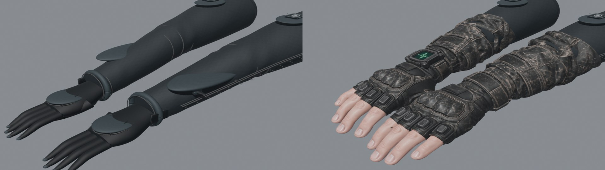
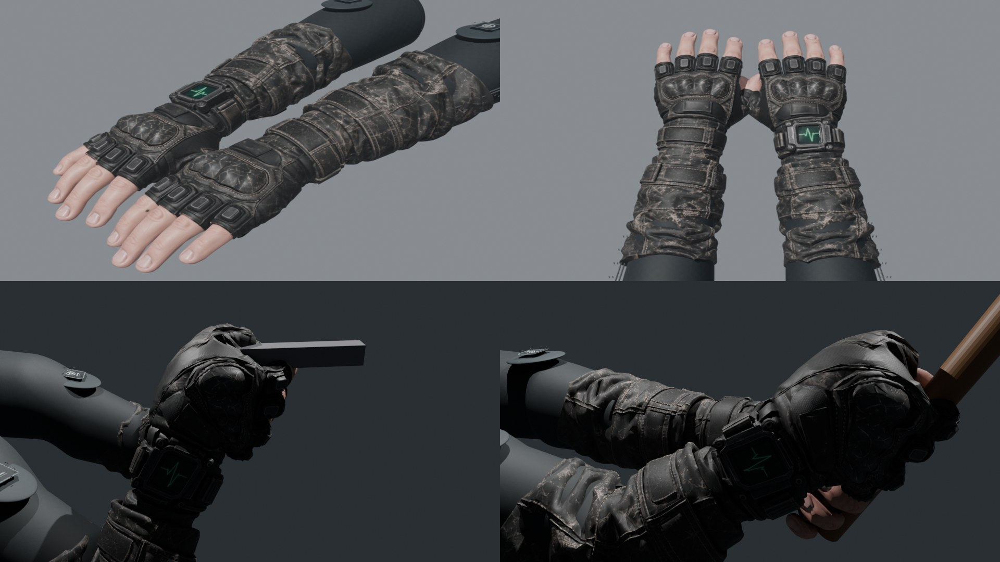

# Meshy operator arms

The first-person arms are now the Meshy tactical forearms: fingerless armoured gloves, padded
sleeves and the wrist vitals monitor, on the **same rig** as the original operator arms. Nothing
about the IK, grips or finger curl changed: `UOperatorArmsComponent` just loads a different mesh.

## How the rig works (why it had to be done this way)

The arms have no animations. `UOperatorArmsComponent` (a `UPoseableMeshComponent`) moves 43
named bones every frame: two-bone IK from shoulder to wrist onto the weapon's grip, the hand
turned to the handle, and each finger curled about its own knuckle axis. It calibrates itself
from the mesh's reference pose (shoulder width -> unit scale, wrist -> middle knuckle and
index -> pinky -> hand orientation), so any mesh works as long as it has those bone names in a
sensible rest pose. A Meshy model has no bones at all, so it has to be put onto that skeleton:

1. `Tools/build_meshy_arms_blender.py` loads the original rigged arms and the Meshy model.
2. On each Meshy arm it finds the five bare fingers from the texture (skin colour), works out
   which is the thumb, which hand it is (from which side the thumb sits), the knuckles and
   finger joints, then the wrist and elbow from hand proportions.
3. It scales/turns each arm (one scale for both) so the wrist sits on the rig's wrist and the
   forearm lies along the rig's forearm, palm down like the rig.
4. It moves the wrist, hand and 15 finger bones into the Meshy hand (same names, same
   hierarchy), keeps the operator's upper arms and drops its old forearms/hands.
5. Automatic (heat) weights, smoothed 3 passes, max 4 bones per vertex, joined into one mesh.
6. Writes `Assets/OperatorArmsMeshy/SK_AH_OperatorArms_Meshy.fbx` + `T_AH_MeshyArms_D/N/MR`
   (2K, normal map flipped to DirectX).

## Getting it in game

- Already built and committed: just run **Tools > Execute Python Script...** ->
  `Tools/import_meshy_arms_ue58.py` (or the whole `Tools/ue_setup_project.py`, which runs it).
- Press Play. The log says `OperatorArms: using SK_AH_OperatorArms_Meshy`.
- To go back: untick **Prefer Meshy Arms** on the pawn's arms component, or delete the asset.

## Swapping in a different Meshy model

1. Put the Meshy download (the FBX and its PNGs, as Meshy zips it) in `Assets/Meshy/arms/`
   (git-ignored), or a single `Assets/Meshy/arms.glb`.
2. `blender -b -P Tools/build_meshy_arms_blender.py` (pip `bpy` works too).
3. Run `Tools/import_meshy_arms_ue58.py` in the editor.

What the model needs (it stops with a clear message otherwise): two separate forearms + hands,
**five fingers each**, hands flat and straight, fingers slightly apart, thumb not touching the
index finger, bare skin on the fingers (fingerless gloves) so the fingers can be found.
Prompt that worked:

> First-person tactical operator forearms and hands only, cut just above the elbow, two separate
> arms side by side, straight and reaching forward, hands flat palm down, five fingers on each
> hand slightly spread, thumbs relaxed beside the index finger, fingerless armoured tactical
> gloves with knuckle protection, padded dark sleeves, a wrist vitals monitor,
> realistic PBR, neutral lighting, no weapon, no body.

## Known limits

- Up close the knuckles crease a bit when the fist is fully closed (low-poly remesh + linear
  skinning); at first-person distance it reads fine.
- The Meshy sleeve stops ~15 cm above the elbow and tucks into the operator's upper arm
  sleeve; that seam is off screen in normal play.
